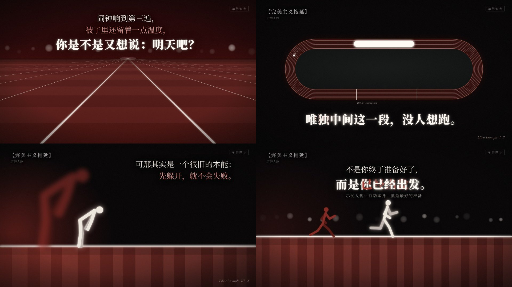

# 3：尼采权力与意志

讲心理、哲学、自我成长这类「一个道理 + 一个隐喻」的横屏 16:9 短片：近黑的暗场里一条赤红跑道，一个发光的米白火柴人，身后跟着一个放大、虚化的红色影子；文字只用宋体，一行一行从模糊里浮出来。画面语法是从一支参考视频里拆出来的（参考视频不进 git，拆解包在 `materials/00-公共/风格蒸馏/crimson-glow/`），组件和示例都是重写的，没有沿用原片的内容、文案、分镜和水印。代码 ID 是 `crimson-glow`，蒸馏时的工作名叫「赤影哲思风」。

## 画面特征

- **底色与质感**：暖黑 `#040203`，四周压暗角；72% 的画面是暗部（亮度 < 0.12），亮部只占 2%，所以发光的东西才显得亮。上面盖一层很淡的胶片颗粒。
- **三种地面**（全片只在这三种地面之间切换）：
  - 透视跑道：地平线在 40% 高度，天空是暗红（`#1c0304` → `#330706`），跑道 `#5c1f1a`（远）→ `#47100c`（近，越近越暗），横向明暗条纹越近越宽（±6% 亮度）；白色分道线从消失点放射出去，远细（2px）近粗（中间两条 22px、两侧 14px），正中两条带光晕；地平线上方一排观众席光斑（17 个失焦灰白圆点，半径 13～32px，忽明忽暗）。
  - 侧视地面：一条发光白地平线在 71.5% 高度（6px 线 + 双层光晕），下面是 `#5a1e19` 的竖条纹地面（近景每条约 100px、远景约 70px，±8% 亮度，往下暗到 `#3a1210`），左红光、右冷光也映在地面上，上方是黑。
  - 俯视椭圆：占满画面宽度的 77%（1480×450），场心近黑偏绿 `#0d0f0e`，8 圈玫瑰色细线 `#b5675e`（2px，间距 10px，跑道底色暗红），白色起终点短线和一行斜体灰色小字。
- **配色**：黑底 + 赤红地面 + 米白（`#ece5dc`，正文、火柴人）+ 纯白光（`#fffaf4`，结论大字、光环、爆闪）+ 玫红（`#d98a80`，强调行）+ 影子红（`#8e2b24`，60% 透明、虚化）。光源有语义：**左边红光 = 退缩的那个声音，右边冷灰光（`rgba(150,145,165)`）= 往前的那个声音**，两个声音打架时两道光同时在。强调色一个画面最多一处。
- **字体**：中文全部宋体（Songti SC / Noto Serif SC）。正文 Regular 58px，行高 1.5；玫红强调行同字号、不加粗；结论行 Black 87px（正文 1.5 倍），带白色外发光；左上概念标签 Bold 38px 灰（`#959193`）加【】，下面一行 22px 斜体作者名；右下西文出处 Garamond 斜体 26px（`#866f6b`）。字都带一层大半径黑色柔投影，文字后面的背景会被压暗一圈，压在亮地面上也读得清。
- **固定版式**：左上概念标签（x 72、y 58）；右上一个 1px 灰描边的小字框（原片是创作者水印，我们只留位置，写自己的账号名）；右下西文出处；文案块位置跟着画面走——透视跑道时在上方居中，侧视时在人物对面的上角（左对齐或右对齐），俯视椭圆时在椭圆下方左右各一句，物体特写时在物体下方居中。
- **出场方式**：每行文字「透明 + 模糊 8px」一起收拢，10 帧完成，先快后慢；同一块里行与行间隔 14 帧，结论行最后出。整块退场也是模糊淡出，10 帧，和下一块重叠 4～6 帧。结论里的关键词有「红色残影」：后面一份暗红色（`#a3352b`）、往左错开约一个字、虚化的同字，前面是发光白字。
- **转场**（几乎不硬切，87 秒只有 7 个硬切，而且多半藏在闪光或压缝里）：
  - 开场：黑场 7 帧淡入。
  - 光环脉冲：点出关键概念时，一圈白色细环从消失点扩到半径约 180px，13 帧，中心一团柔光，整个画面亮一下。
  - 标题收进角标：画面中间的概念大标题（Black 110px + 灰色副题）模糊放大淡出，同时左上角标签柔入，12 帧。
  - 升机位：透视跑道放大并向上扫出画面，俯视椭圆从 1.25 倍缩回 1 倍淡入，两者重叠约 10 帧。
  - 压缝翻开：物体先 7 帧压成一条亮灰细缝（ease-in），再 8 帧展开成下一个物体（ease-out），共 15 帧。
  - 墨团吞没：一团边缘不规则的黑墨从中心长大，约 36 帧吞满；原片里句子的关键词同时化掉（`Lines` 没有内置这一步，需要时把关键词拆成单独一块、提前 `out`）。
  - 溶解：文字卡淡出、新场景淡入，重叠 12 帧，新场景的地平线先亮。
  - 白光爆闪：中心一团白光 6 帧冲到最亮，再 10 帧散开，最亮那一帧换场景。
  - 推近穿线：镜头朝一段发光线推近（约 20 帧放大 6 倍），线变成下一场的地平线。
- **镜头**：基本静止，不慢推；所有运动都在元素身上（小人走 / 跑、光点绕圈、线被画出来），大幅推拉只出现在转场里。
- **节奏**：平均镜头 10.9 秒、最长一镜 48 秒；一块文案停 3～5 秒；运动强度大部分时间几乎为零，尖峰全部是转场（光环、升机位、压缝、爆闪、推近）。配乐约 90 BPM 的钢琴，转场没有严格卡小节线。
- **招牌画面**：
  1. 透视赤红跑道 + 地平线上一排观众席光斑 + 上方三行宋体（米白 / 玫红 / 加粗白）。
  2. 侧视地面上一个发光米白火柴人，身后一个大一倍多、虚化的红色影子火柴人，左红右冷两道光。
  3. 俯视椭圆跑道上一颗光点绕圈，经过起点亮一圈光环，到终点荡开同心涟漪。

## 组件

| 文件 | 组件 |
|---|---|
| `src/library/crimson-glow/theme.ts` | 配色 `C`、字体 `CF`、`blurIn` 模糊柔入、`vis` 两头淡入淡出、`glow` 发光滤镜、`inkShadow` 文字柔投影、`heroGlow` 结论大字发光、`withAlpha` |
| `src/library/crimson-glow/stage.tsx` | `DarkStage` 暗场（左红光 / 右冷光）、`Vignette` 暗角、`Grain` 颗粒、`Bokeh` 观众席光斑、`TrackFloor` 透视跑道（横档由远到近亮起）、`SideFloor` 侧视地面（可滚动、映出左右两道光）、`Lines` 逐行柔入的文案块（米白 / 玫红 / 结论 / 两种「声音」/ 小字，`【词】` 带红色残影）、`ConceptTag` 左上概念标签、`ConceptTitle` 概念大标题收进角标、`SourceLine` 右下西文出处、`BrandTag` 右上账号框、`Soft` 柔入容器 |
| `src/library/crimson-glow/props.tsx` | `GlowFigure` 发光火柴人（`pose` 站 / 垂头 / 走 / 跑，`mixPose` 过渡，`tone` 米白或影子红，`ghost` 虚化放大，`bloom` 身上光团）、`joints` 关节计算、`OvalLoop` 俯视椭圆跑道（绕圈光点、点亮一段）+ `ovalPoint`、`ClosedBook` 合上的书（书口那面）、`OpenBook` 摊开的本子、`Chasm` 断崖和横跨的线（落脚点逐个点亮） |
| `src/library/crimson-glow/fx.tsx` | `RingPulse` 光环脉冲 / 同心涟漪、`Flash` 白光爆闪、`InkSwallow` 墨团吞没、`SlitSwap` 压缝翻开、`Flyover` 透视 → 俯视升机位、`PushThrough` 推近穿线 |

## 关键代码

- 素材库：`src/library/crimson-glow/`（目录见 `src/library/README.md`「3：尼采权力与意志」一节）
- 预览：Studio 里的 `library-crimson-glow`（`src/library/previews/CrimsonGlowDemo.tsx`，40 秒，8 场，题目是「拖延」，文案自己写的）

## 没有搬的东西

- **文案**：原片讲尼采，所有台词、标题、概念名、书名出处都没带进来；预览换成「拖延 / 等准备好再开始」，引用写「示例文献」「示例人物」。
- **分镜**：原片「跑步跑到一半 → 背单词书 → 走钢丝变成桥」这条故事线没有照搬；`Chasm` 是自己设计的「落脚点逐个点亮」，不做绳子变拱桥。
- **水印**：右上角原片是创作者的账号框，只学了位置和描边样式，内容由 `BrandTag` 的 `text` 传入。
- **人物**：火柴人是通用画法，比例和姿势重新设计；原片没有版权角色。
- **配乐**：原片的钢琴配乐不进仓库，预览不带声音。
- **风格名**：「3：尼采权力与意志」只是这套风格在仓库和配方卡里的内部名字，不会出现在画面上；做期数时左上概念标签写每期自己的概念。
- **原片的帧、拆解报告和切片**都放在 `materials/`（不进 git），原片本身在 `template/`（不进 git）。

## 还没做到

- **还没用 Remotion 真渲染过，也没跑过官方检查**：蒸馏时会话里装不上 npm 依赖（包管理源连不上），所以：
  - 没跑 `npm run typecheck`，类型错误要等能装依赖的环境才查得出来；
  - `tests/library/crimson-glow.test.ts` 的 6 条断言是转译后用 node 加一个简易断言替身跑的（全部通过），没经过 vitest，也没跑整个工程的 `npm test`；
  - `预览.jpg`、两轮对照自查和 40 秒预览小样，用的是临时替代渲染器（esbuild 打包组件 + 一个 remotion 替身，Chromium 逐帧截图），画的是同一份组件代码，但没经过 Remotion。
  - 下次在能装依赖的环境里先跑 `npm run typecheck && npm test`，再在 Studio 里打开 `library-crimson-glow` 从头看一遍动效。
- **字体**：替代渲染时这台机器没有 Songti SC，中文落到了 Noto Serif CJK；Mac 上会用宋体，字形略有差别。渲染环境如果连 Noto Serif 都没有，会回落成黑体，气质差很多，渲染前先确认。
- **自查时已经改掉的**：正文字号 46 → 58px；透视分道线加粗（中间两条 22px）；天空改成暗红；俯视椭圆和书放大到原片比例；侧视地面条纹变窄、映出左红右冷两道光；红色影子保持垂头、放到最左边；关键词红色残影加深加大错位。
- **和原片相比还差一点的**：原片「墨团吞没」时句子里的关键词会同时化掉，`Lines` 没内置这一步；升机位（`Flyover`）是把透视跑道整层放大上扫、再淡入俯视椭圆，不是同一条跑道在 3D 里真正翻过去；预览小样是 15fps，动作看起来比正式渲染顿。

## 期数

还没有正式使用的期数。
