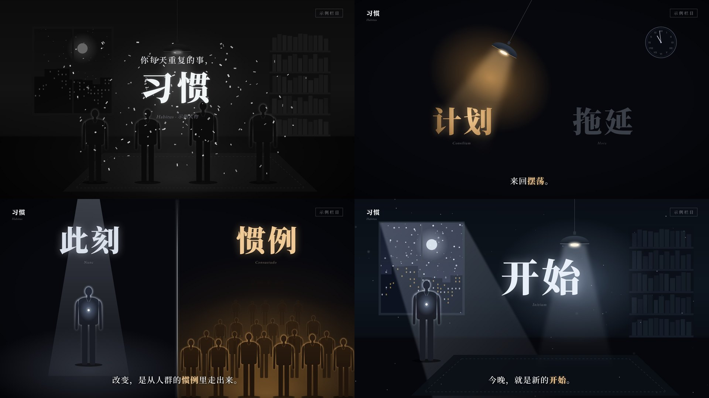

# 夜灯哲思风

讲哲学、心理、情绪话题的横屏 16:9 无口播短片：深夜的房间、一盏吊灯、一个心口发光的剪影人，画面安静，字幕当旁白。它像一段深夜独白，适合讲「为什么会这样」这类向内看的题目。画面语法是从一支参考视频里拆出来的（参考视频不进 git），组件和示例都是重写的，没有沿用原片的内容、文案和水印。

## 画面特征

- **底色与质感**：大面积近黑，暗部（亮度 < 0.12）约占画面 2/3。暗场底色 `#07080d`，四角压到 `#020306`。房间是扁平矢量的冷蓝灰（墙 `#0d151e`、沙发 `#1b232c`、地面 `#06070c`），用渐变做体积，不描边。画面里一直飘着灰白浮尘，在光锥里看得最清楚。
- **两套光**：冷光是月光和白灯，冷白 `#e8eff8`、月亮 `#dce4ed`、窗外夜空 `#282f46`。暖光是吊灯、回忆和人群，琥珀色从暗到亮依次是 `#4d3a24`、`#7f5d37`、`#e5be89`、`#ffd8a1`。冷代表「现在、独处、清醒」，暖代表「热闹、欲望、回忆」，一个画面里通常只有一种光占主导。
- **强调色规则**：彩色像素只占画面 4.4%。字幕里的重点词变成琥珀色 `#e5be89`，一句最多一处。大关键词被灯照到的部分亮、照不到的部分暗。
- **字体**：中文全部用宋体。大关键词和标题用 Black 字重，字幕和章节名用 SemiBold。西文用斜体衬线小字（德文 / 拉丁文术语、人物名和年份），颜色是灰 `#767b84`～`#959aa2`。
- **字号层级**（1920 宽）：标题 180px，大关键词 160～200px（一屏几个词时用 160，单独一个用 180～200），标题上方引导句 44px，字幕 44px（底边在 1012），章节名 34px，西文小字 16～22px。
- **固定版式**：左上角章节名（中文粗宋 + 下面一行西文斜体），右上角细线框栏目名，栏目名下方可以放「人物名 + 生卒年」两行斜体，底部居中字幕。人物卡只在讲到这个人的那一段出现。
- **出场**：标题逐字模糊收拢，每字间隔 4 帧、8 帧完成，模糊从 14px 收到 0。大关键词约 10 帧模糊收拢。字幕先 8 帧淡出，再 6 帧淡入，旧字幕走完新字幕才进。标题定格约 1 秒后缩小，约 15 帧飞到左上角变成章节名，这一手是开场的招牌动作。
- **转场**：多数是暗场叠化，前一场先暗下去约 20 帧，下一场再亮起来，有一个元素保持不动当桥，原片常用吊灯。推进一道光门时，画面在 3 帧内闪白，再从白里淡出下一场。开场把彩色画面去色成灰，同时飘起一阵灰白纸屑，标题从纸屑里出来。
- **镜头**：基本不动。收尾时缓慢推近约 6%，窗外星点同时变多。
- **节奏**：119 秒里有 10 次硬切，平均镜头 10.8 秒，元素在同一个画面里进出。字幕间隔中位数 2.5 秒，跟阅读速度走，不卡配乐小节线（相位集中度 0.25）。配乐约 112 BPM、一小节约 2.13 秒，只有少数关键点落在拍上，比如第一个硬切、闪白。音量层次：开头 20 秒较轻，17 秒处抬升约 5 dB，78～94 秒的安静段压低约 3 dB，94 秒后回到原来的响度收尾。
- **招牌画面**：
  1. **吊灯钟摆**：吊灯来回摆，一个来回约 72 帧、摆幅约 28°，光锥扫到哪个关键词，哪个词就亮起来。
  2. **分屏对照**：一条竖直的发光细线把画面分成两半，左边冷色聚光灯下站一个人，右边是暖色的一大片人，两半各配一个大字和一行西文。
  3. **心口发光的剪影人**：站着或坐着的冷色剪影，带一圈轮廓光，胸口一点白光。在人群里只有他是冷色。
  4. **两道光门**：黑屋里两扇发光的门，门前地上投出光，推进其中一扇时闪白。

## 组件

| 文件 | 组件 |
|---|---|
| `src/library/nocturne/theme.ts` | 配色 `N`、字体 `NF`、字号 `NS`、`blurIn` 模糊收拢、`charIn` 逐字、`fadeSwap` 字幕换句、`readFrames` / `lineStarts` 按字数排字幕、`swing` 钟摆角度、`dip` 暗场叠化、`flash` 闪白、`flyTo` 飞到角落、`pushIn` 收尾慢推 |
| `src/library/nocturne/stage.tsx` | `NightBg` 暗场底 + 暗角 + 光晕、`Motes` 浮尘、`ChapterMark` 左上章节名、`SeriesTag` 右上细线框、`PersonNote` 人物名 + 年份、`NSubtitle` 底部字幕（【】标重点词）、`TitleCard` 逐字标题 + 飞到角落、`Shards` 纸屑、`Desat` 去色、`LitWord` 被灯照亮的大字、`SplitDuo` 分屏对照、`MemoryPhoto` 暖色回忆照片、`Dip` 暗场叠化、`WhiteFlash` 闪白 |
| `src/library/nocturne/props.tsx` | `PendantLamp` 吊灯（可摆、冷 / 暖）、`lampSpot` 光斑落点、`Figure` 站立剪影人（轮廓光 + 心口光点）、`SeatedFigure` 坐着的剪影、`Crowd` 一片暖色人群、`Chatter` 飘着的闲聊小字、`LinkArcs` 人与人之间的虚线弧、`LightDoor` 光门、`NightWindow` 月夜窗、`StudyRoom` 冷色书房、`WallClock` 罗马数字挂钟、`MoonPainting` 挂画 |

## 关键代码

- 素材库：`src/library/nocturne/`（目录见 `src/library/README.md`「夜灯哲思风」一节）
- 预览：Studio 里的 `library-nocturne`（`src/library/previews/NocturneDemo.tsx`，45 秒，9 场）

## 没有搬的东西

- 原片的标题、字幕文案、哲学家名字和生卒年、右上角的创作者水印，一个都没进素材包。预览里用的是自己写的题目「习惯」，人物名写「示例人物」，右上角写「示例栏目」。
- 原片里哲学家的侧脸剪影是真人肖像，没做。原片聚会客厅、年夜饭桌这些具体场景也没做，房间换成了冷色书房。
- 原片剪影人胸口是一枚白色菱形，这里换成一颗圆形「余烬」光点，轮廓和比例都重新画过。
- 配乐不进素材包。要做正片，从音乐库（`public/music/`）选授权清楚的曲子，用 `beats.py` 重测网格，并在这一期的素材来源里写明授权。

## 期数

还没有正式使用的期数。
