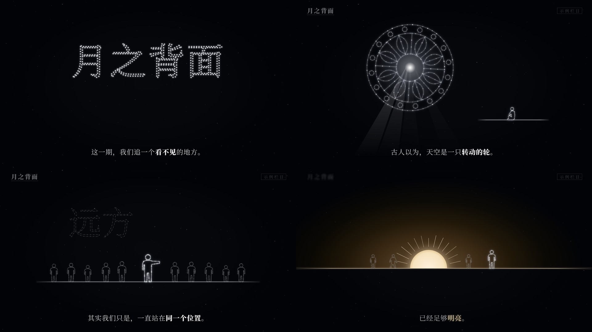

# 星图线描风

讲哲学、心理、天文、人生选择这类「一个问题追到底」的横屏 16:9 无口播短片：整片近乎黑白，所有东西都是星图一样的点线描——人、器物、文字都由一颗颗星点串起来，聚拢、连线、点亮，又在冲击里碎成星尘；只有结尾一次暖金日出。画面语法是从一支参考视频里拆出来的（`虚无主义参考`，不进 git，拆解包在 `materials/00-公共/风格蒸馏/constellation/`），组件和示例都是重写的，没有沿用原片的内容、文案和水印。

## 画面特征

- **底色与质感**：近黑偏冷 `#030407`；中间一块几乎看不出的椭圆亮区（中心 `#07080c`，约 72%×82% 画面，边缘回到 `#020306`），每帧约 170 颗 1–2px 的星点（亮度 120–240）各自缓慢闪烁。没有颗粒、没有纸纹，干净。
- **配色**：97% 的画面是黑白灰，按亮度分层而不是按颜色：
  - 星点节点 `#f9fafd`（带 4–6px 白色光晕），连线 `#b3b4b8`（约 70%，1–1.5px）
  - 陈述大字 `#f2f4f9`（带柔光），字幕 `#cecfd3`（81%），字幕关键词加粗并提亮到 `#dddddf`
  - 配角 / 人群 / 幽灵字 42%（`#6b6c6f`），左上章节签 47%（`#78797c`），右上栏目框 22%（`#393a3d`），斜体年代注 35%（`#58585b`）
  - **唯一的彩色是暖金，整片只出现一次，放在最后的「答案」上**（强调色像素只占全片 0.2%）：字幕关键词 `#c9b897`、地平线 `#fae8cc`、日出核心 `#fff1dd` → 光晕 `#412e17` → `#181101`
  - 反转场（白纸）：中心 `#f1f1ec`，四角强暗角 `#c8c8c5`；主角是黑色实心剪影，人群 `#91918e`，地面线 `#373734`
- **字体**：全片宋体。
  - 字幕：常规字重 44px，整句居中；关键词加粗 + 提亮；最后一个关键词变金
  - 陈述句（问句 / 金句）：宋体 Heavy 80px，字距 0.12em，柔光
  - 爆点字：140–180px，逐字模糊收拢
  - 点阵大标题：约 240px，由星点组成
  - 幽灵字：约 220px，42% 灰的星图字，放在主体左上，衬托不抢戏
  - 角标：左上章节签 40px 粗宋 + 下划线；右上栏目框 26px 宽字距 + 1px 细边框；下面一行西文斜体（年代 / 书名）24px
  - 开场冷开问句：宋体 Heavy 76px 白字带阴影，压在画面上方 y≈175
- **固定版式**：
  - 字幕中心 y=987（画面 91.4%），水平居中
  - 左上章节签 (72, 50)；右上栏目框右边距 64、上边距 50，框下一行斜体注右对齐 y≈122
  - 主体放在 y 200–760；有地面时地面线在 y=760（70%），结尾升高到 y=666（62%）
  - 主体居中，配角人群在两侧压暗；留白多，一屏只讲一个形
- **出场方式**：
  - 字幕整句换：淡出 6 帧 → 黑 2–3 帧 → 淡入 7 帧（模糊 6px→0 + 透明），不位移。47 次切换的中位数
  - 星图聚形（招牌）：散点在主体周围浮现 → 聚拢就位 → 连线沿弧扫出 → 细节补齐 → 中心光点亮，共约 78 帧（20 + 12 + 24 + 10 + 12）
  - 陈述大字：模糊 + 透明一起收，约 14 帧
  - 爆点字逐字：每字 6 帧模糊收拢，字与字间隔 6 帧
  - 配角：只淡入到 40% 亮度
- **转场**（这是一个「同一块夜空里变形」的风格，几乎不剪）：
  - 真硬切全片只有 1 次：片尾硬切回片头，首尾循环
  - 开头问句蒙太奇：每 0.6–0.8 秒换一句，4 帧快溶
  - 冲击闪帧 2 次：1–2 帧「反相」（黑底变白、白线白字变黑，四周略灰，像一张底片，不是纯白）→ 放射线 + 冲击波环约 12 帧扩到半屏 → 主体碎成星点飘散
  - 白纸反转：进白纸 6 帧淡白（快），出白纸 45 帧慢溶回夜色（慢）
  - 粒子溶解：一屏内容碎成点、点飞散、再聚成下一个形
  - 机器报告记了 9 个「硬切」，逐帧看过，其中 7 个是闪白 / 溶解，不是剪辑点
- **镜头**：大部分静止，没有持续慢推；只有「有动机的推拉」——一个段落里 3 秒缓入缓出拉远约 30%（让人群进画），或推近到某个细节
- **节奏**：165.7 秒、54 句字幕，句与句起点间隔中位数 2.70 秒（p25 2.30 / p75 3.30），每句停留中位数 2.17 秒；约 18 个画面设定，平均 9 秒换一个形；运动强度长期极低（0.003），尖峰只有 4 个，都是闪白和溶解
- **配乐**：纯音乐、无人声。112.9 BPM 的电子氛围曲，77% 能量在 60Hz 以下（低频长音铺底），一首约 126 秒的曲子循环一遍。**不卡拍**：字幕起点落在拍子 ±2 帧内的只有 22%（随机是 25%）。只做段落级对位：前奏 0–10.8 秒 → 抽空 10.8–16.9 → 17.2 进鼓 → 87.3–93.5 再抽空（第二个冲击白闪落在抽空里）→ 93.6 进鼓
- **招牌画面**：① 星点聚成的大字标题；② 点线描的人、器物、几何轮被「画」出来，中心光点亮起；③ 一串词连成的长链被一声冲击白闪震碎成星尘；④ 全片黑白，最后地平线上升起唯一一次暖金日出

## 组件

| 文件 | 组件 |
|---|---|
| `src/library/constellation/theme.ts` | 配色 `K`、字体 `KF`、`glowWhite` / `glowGold` 发光、`haze` 模糊柔入、`RHYTHM` 节奏常量、`capFade` 字幕淡出—黑—淡入、`paceLines` 按 2.7 秒节奏排字幕、`reframe` 有动机推拉、`flashAt` 闪帧曲线 |
| `src/library/constellation/geom.ts` | 星图几何（纯函数）：`line` `poly` `arc` `circle` `ellipse` `bezier` 取点、`resample` 等距串珠、`lengths` / `cut` 按长度截断、`place` / `mirror` 摆放、`scatter` 散点起点、`pathD` |
| `src/library/constellation/stage.tsx` | `NightSky` 夜空底（椭圆亮区 + 闪烁星点）、`PaperSky` 白纸反转底 + `inverted` 进快出慢的反转进度、`ChapterTag` 左上章节签、`SeriesBox` 右上栏目框 + `note` 斜体注、`KCaption` / `KCaptions` 字幕（`【】` 加粗提亮、`〔〕` 变金）、`Statement` 陈述大字、`ImpactWord` 逐字爆点字、`HookLine` 冷开问句、`DotWord` 星点大标题（星尘聚拢 / 炸开）、`GhostWord` 幽灵星图字、`FlashFrame` 反相闪帧、`Impact` 冲击波 + 放射线、`Stardust` 星尘溶解转场（`out` 飞散 / `in` 聚拢）、`Reframe` 推拉镜头容器、`Haze` 柔入容器 |
| `src/library/constellation/props.tsx` | `StarShape` 通用星图形（`gather` 聚拢 / `draw` 连线 / `shatter` 碎裂）、`Figure` 星点小人（站 / 走 / 指 / 坐，`dim` 配角，`paper` 白纸场黑剪影）、`Crowd` 一排配角、`StarWheel` 几何星轮（聚拢 → 扫弧 → 补细节 → 中心点亮 → 光柱）、`OrbitMap` 轨道图（斜体标签）、`Planet` 星点星球（`mark` 朝向小旗）、`OpenBook` 打开的书、`Steps` 台阶、`Kite` 风筝、`PaperPlane` 纸飞机、`Horizon` 地平线（从一侧画出，`gold` 暖金）、`Sunrise` 暖金日出、`WordTrail` 词语长链（沿曲线逐字长出、可碎裂） |
| `src/library/constellation/puppets.tsx` | 冷开用的灰阶「提线舞台」：`PuppetStage`（丝线幕 + 聚光 + 地面光斑，`fall` 断线坠落）和原创关节人偶 `Mannequin`（站 / 低头 / 走 / 抬头，`drop` 瘫下） |

## 对照自查记录

- 第 1 轮：冲击帧从纯白改成反相底片；第 4、5、10 场重新构图（离原片的分镜太近）；陈述大字避开道具；斜体注从 Playfair 粗斜体换成 Garamond 细斜体；月球朝向小旗放大
- 第 2 轮：星轮节奏对齐原片（前 11 帧空、22 帧稀疏冒点、33 帧扫弧、78 帧点亮），星点从串珠改成「细线 + 稀疏节点」；散点逐颗冒出；点阵标题的点加大加稀；日出光晕铺宽
- 已知差距：`DotWord` 用字形描边做点，是双排点，原片是沿笔画中线的单排点；要一模一样得换成预先采样的字形中线

## 关键代码

- 素材库：`src/library/constellation/`（目录见 `src/library/README.md`「星图线描风」一节）
- 预览：Studio 里的 `library-constellation`（`src/library/previews/ConstellationDemo.tsx`，50 秒，10 场把所有组件演一遍；示例题目是「为什么我们只能看到月亮的一面」）

## 没有搬的东西

- 原片的题目、问句、字幕、引文、人名、书名全部没用；预览作品换成了月亮背面的题目，西文斜体注用「示例」占位
- 原片右上角的栏目名水印没有复制：`SeriesBox` 只保留位置和样式，文字由每期自己传
- 原片里的动物形象和分镜顺序没有搬：素材包只提供通用的星图画法（`StarShape` 吃任意点线）、小人、几何轮和词语长链这种手法
- 冷开的提线人偶是重新画的关节人偶，和原片的造型、动作、场景编排不同
- 原片配乐不进素材包；做正片时走音乐库（`public/music/`），授权未确认的曲子不要用

## 期数

还没有正式使用的期数。
