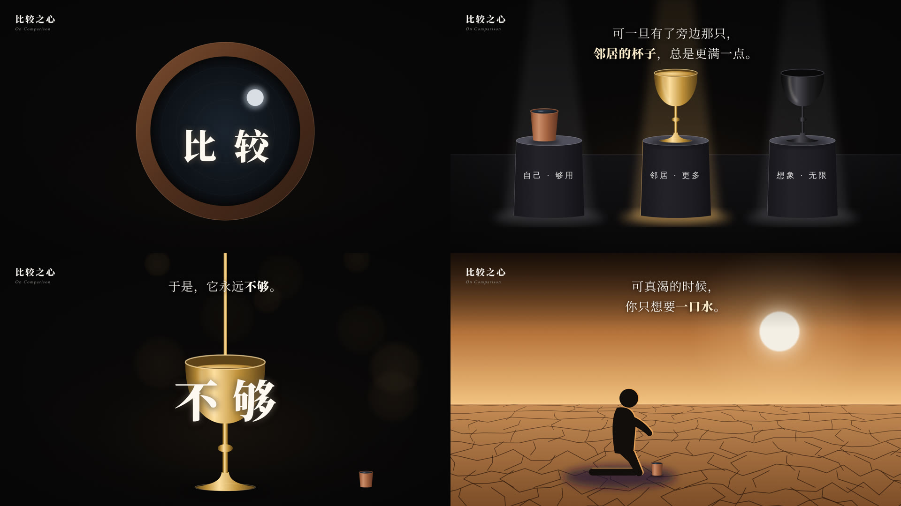

# 金器剧场风

讲哲学、心理、生活道理的横屏 16:9 无口播短片风格，像在一座暗场小剧院里看一件件器物说话：近黑舞台、顶光光柱、金属质感的金杯、陶杯、展台，人物只是一团剪影；字幕在顶部居中，锚词逐字从模糊里浮出来。画面语法是从一支参考视频里拆出来的（`template/ref01.mp4`，约 169 秒，不进 git），组件和示例都是重写的，没有沿用原片的内容、文案和水印。

## 画面特征

- **底色与质感**：近黑偏暖（#030202 ～ #090705 占画面一半，平均亮度 0.12），四角压暗角；暗场里浮着几颗很虚的暖色散景光斑和细小浮尘。三种场景底色作为变体：
  - **暗场**（默认）：近黑 + 顶光光柱，器物、展台都在这里
  - **黄昏**：上暗下亮的琥珀渐变天空（#3a1d0c → #f2c27e），一轮发虚的白日，地平线下是龟裂土地（透视网格），给「渴、苦、匮乏」的段落
  - **夜海**：深蓝黑（#06080b）+ 星点 + 一条很淡的地平线，给结尾和「回到自己」的段落
- **配色**：只有四类。暗底；金（金器本体 #be8f36 → 高光 #fdde9e、暗边 #845b1e，重点字 #f7e8c7）；陶土铜红（朴素的那一方：陶杯 #a15f3d、杯口环）；冷石灰（展台 #201e26、台面 #4c4c58）。**金 = 欲望 / 奢侈，陶 = 朴素 / 够用**，这是贯穿全片的语义，不要混用。
- **字体**：中文全部宋体（`Songti SC` / `Noto Serif SC`），字幕常规字重、重点词加粗变暖白；锚词用最粗的宋体，160px 以上；西文小字用 Garamond 斜体。
- **固定版式**：
  - 左上角主题签：中文宋体粗 38px（#f6f4f2）+ 下面一行 Garamond 斜体 18px 灰（#9f9d97），x≈64、y≈55。整片不变。
  - 顶部居中字幕：1～3 行，宋体 52px，#f5f2ee，第一行中心 y≈140、行距 ≈86px；重点词加粗，金色重点词 #f7e8c7。字幕始终在顶部，画面主体在中下部。
- **出场方式**：
  - 字幕：模糊 + 透明一起柔入，约 12 帧；换句时上一句模糊淡出约 10 帧，新句再进来（不叠）。
  - 锚词：**逐字柔入**，每个字从模糊放大里收拢，约 8 帧到位，字与字间隔 5～6 帧（三个字约 0.4 秒出齐）。
  - 下划线词：词浮出后下面画一条细线；词淡出、线留下，线接着变成下一场的地平线 / 桌面线。
- **转场**：整片只有 7 个硬切，其余全是 **0.5～0.7 秒的交叉淡化**；常用「元素贯穿」——上一场的线、杯口、光柱在下一场继续存在（例：俯视杯口的圆环 → 淡化进黄昏大地；下划线 → 展台的地平线）。
- **镜头**：几乎不动；长镜头里极慢推近（每场 2～3%），器物「被撑大」时直接放大器物本身而不是推镜头。
- **节奏**：平均每 3 秒换一句字幕，每 10～20 秒换一个场景底；运动强度长时间很低，只在锚词、爆点处出现尖峰。配乐约 128 BPM（小节 1.87 秒），字幕切换卡小节线，锚词踩重拍。
- **招牌画面**：
  1. 三个展台排一排，各自一道顶光；被点到的那台光柱变金，其余保持冷灰。
  2. 金杯从上面不停注入细金流，杯子一边接一边变大，锚词砸在杯身上。
  3. 俯视杯口：铜红圆环 + 深色水面 + 一颗月亮倒影，开头和结尾各出现一次（首尾闭环）。
  4. 剪影人物跪在龟裂大地上，背后一道暖色轮廓光。

## 组件

| 文件 | 组件 |
|---|---|
| `src/library/vessel-stage/theme.ts` | 配色 `V`、字体 `VF`、`fadeBlur`（模糊柔入 / 淡出）、`charIn`（逐字入场进度）、`vis`（场的交叉淡化）、`parseMarks`（字幕重点标记） |
| `src/library/vessel-stage/stage.tsx` | `DarkStage` 暗场底、`Vignette` 暗角、`DuskSky` 黄昏天空 + 白日、`NightSea` 夜海星空、`SpotBeam` 顶光光柱、`Bokeh` 散景、`Dust` 浮尘、`Grain` 颗粒、`TopicTag` 左上主题签、`TopCaption` 顶部字幕、`AnchorWord` 逐字锚词、`UnderlineWord` 下划线词 |
| `src/library/vessel-stage/props.tsx` | `Chalice` 金杯（可变大小、液面、注流）、`ClayCup` 陶杯、`Pedestal` 展台（带标签、可点亮）、`CupRing` 俯视杯口、`Figure` 剪影人物（站 / 跪）、`CrackedGround` 龟裂大地、`BurstRays` 放射光 + 彩屑 |

## 关键代码

- 素材库：`src/library/vessel-stage/`（目录见 `src/library/README.md`「金器剧场风」一节）
- 预览：Studio 里的 `library-vessel-stage`（`src/library/previews/VesselStageDemo.tsx`，40 秒，8 场；示例题目「旁边那只杯子」，讲社会比较，和原片无关）

## 没有搬的东西

- 原片的题目、全部字幕文案、左上角主题签的文字，一个字没带进来；主题签只学了「中文粗宋 + 西文斜体」的版式。
- 原片的分镜顺序、具体场景（宴会长桌、花园门口、彩票、拉丁文碑文等）没有复刻；预览作品用的是自己编的题目和场景。
- 原片里的人物都是无脸剪影，我们的 `Figure` 是重新用几何形状搭的。
- 原片配乐不进素材包；做期数时用自己有授权的曲子，用暗金风 skill 的 `beats.py` 重测拍子。
- 原片的帧、拆解报告和切片都放在 `materials/`（不进 git）。

## 还没做到

- **还没用 Remotion 真渲染过**：这次蒸馏时会话里装不上 npm 依赖（包管理源连不上），所以：
  - 类型检查是用全局 TypeScript + react / remotion 的类型桩做的，只覆盖这套素材包的 5 个文件，没跑整个工程的 `npm run typecheck`；
  - `tests/library/vessel-stage.test.ts` 里的断言是转译后用 node 直接跑的，没经过 vitest；
  - `预览.jpg` 和两轮对照自查用的是一个临时的静态渲染器（把组件直接输出成 HTML，用 Chromium 截图），画的是同一份组件代码，但没经过 Remotion，动效只抽查了逐字入场的中间帧。
  - 下次在能装依赖的环境里先跑 `npm run typecheck && npm test`，在 Studio 里打开 `library-vessel-stage` 从头看一遍动效。
- 自查时已经改掉的：金杯杯身太浅、杯脚像方块、液面横在杯身前面（改成深圆碗 + 扁圆杯脚、液面裁在杯口里）；杯身高光像一根白线（改成柔光）；龟裂大地像砌砖（加大裂纹抖动）；剪影脚下影子太淡；放射光边缘太硬；跪姿手臂太细。
- 和原片相比还差一点的：龟裂大地的裂纹仍比原片规整；白日边缘原片是不规则发虚的，我们是正圆加模糊。
- 渲染环境如果没有中文宋体（Songti SC / Noto Serif SC），字会回落成黑体，气质差很多；渲染前先确认。

## 期数

还没有正式使用的期数。
